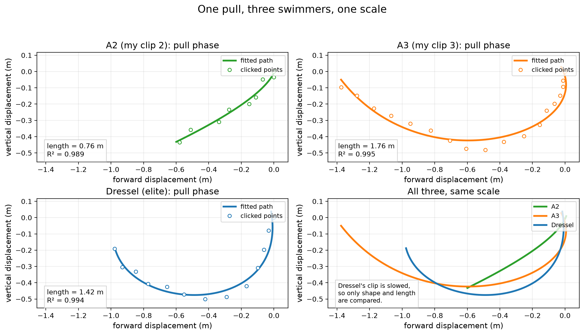
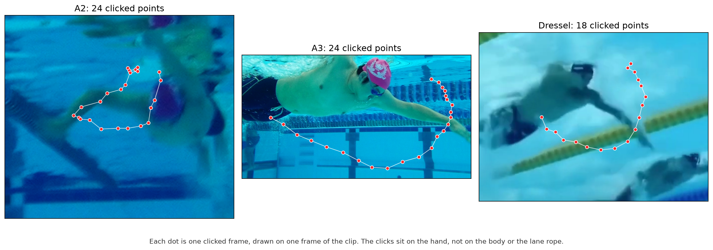
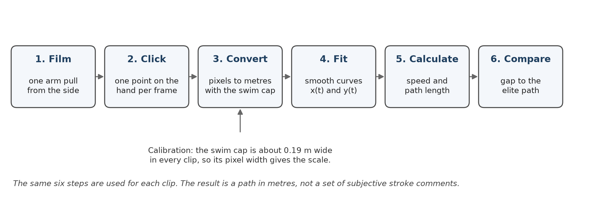
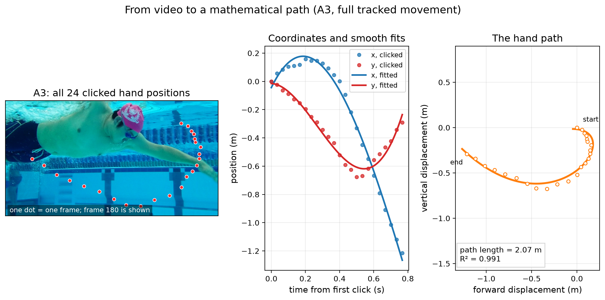
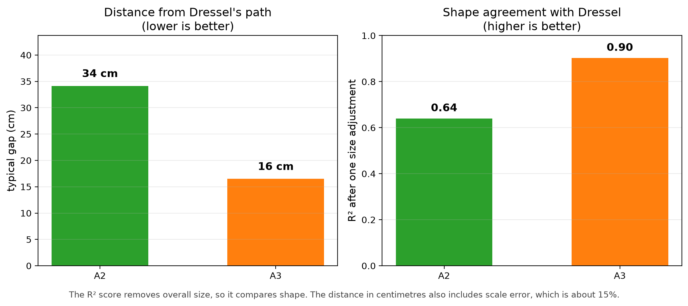

# Math IA: my underwater hand path compared with Caeleb Dressel

This is my IB Mathematics Exploration. The question is:

> **When my hand sweeps through the water in a 50 m freestyle sprint, what path does it trace, and how does that path compare with the same phase swum by an elite sprinter, Caeleb Dressel?**

I answer it by digitising the hand in three videos, fitting smooth parametric curves, and using derivatives, arc length, and RMSE to compare the paths. You do not need to read or run code to follow the project. The figures and tables below contain the whole argument. The code is included only so the numbers can be checked.

## The short answer

- **A3 gives the cleaner comparison.** Its pull path is about **16 cm** from Dressel's on average, and Dressel's curve explains about **90%** of the shape of A3's path after allowing for one overall size difference.
- **A2 is much shorter and much coarser.** Its pull has only **9 points over 0.27 s**, so I treat it as indicative. Its path is about **34 cm** from Dressel's, and the shape score is **0.64**.
- **All three paths are smooth enough for a simple curve.** A cubic (or, for A2, a quadratic) fits each pull with **R² between 0.989 and 0.995**.
- **Dressel's hand travels 1.42 m** in the pull, **A3's travels 1.76 m**, and **A2's travels 0.76 m**. The elite clip is slowed, so I do not compare absolute speed with Dressel.

The two numbers that matter most are the **typical gap** and the **shape score**. The gap is easy to picture: it is the average distance between the two paths in centimetres. The shape score is an R² that removes overall size, so it asks whether the two curves have the same shape, not whether one is larger.



*Figure 1. The pull phase of each clip, drawn at the same physical scale. Each open circle is one digitised frame. The solid line is the fitted polynomial. A2's pull is short, A3's is about the same size as Dressel's, and Dressel's curve sits between the two.*

## What I am comparing

The hand does not move in a straight line. It enters in front of the head, sweeps down and back under the body, and then leaves the water for the recovery. The path is a curve in two dimensions, so I write it as a **parametric curve**:

```
r(t) = (x(t), y(t))
```

Here `x` is the forward direction and `y` is the vertical direction. `t` is time.

The comparison has three parts:

1. **Fit** each path with smooth polynomials `x(t)` and `y(t)`.
2. **Differentiate** the polynomials to get hand speed, and **integrate** the speed to get the length of the path.
3. **Compare** my path with Dressel's after putting both on the same normalised time, so the comparison is about shape and not about how long the clip lasts.

The full mathematics is in [docs/03_method.md](docs/03_method.md).

## The data

The data are three short clips:

| Label | Swimmer | Clip | Resolution | Nominal frame rate | Tracked frames | Hand points | Time base |
|---|---|---|---|---|---|---|---|
| A2 | me | `a2yifan.mov` | 1920 x 1080 | 29.97 fps | 317 to 340 | 24 | real time |
| A3 | me | `a3yifan.mov` | 1920 x 1080 | 29.97 fps | 171 to 194 | 24 | real time |
| Dressel | Caeleb Dressel | `dressel.mp4` | 1280 x 720 | 60 fps | 642 to 778 | 18 | slowed footage |

**A2 and A3 are two clips of the same swimmer, me. They are not two different people.** The labels are just the names of the files.

I clicked the hand position by hand in every usable frame. I did not use automatic tracking for the final data. Automatic tracking was tried first, but it drifted when the hand crossed the splash or the body, so the final coordinates come from manual clicks. The clicker shows a magnified view of the cursor, and it skips frames that are exact repeats, so every click lands on a new picture.



*Figure 2. The clicks checked against the video. Each dot is one clicked frame, drawn on one frame of the clip. The clicks sit on the hand, not on the body or the lane rope.*

The scale comes from the swimmer's cap. I measured the cap width in pixels in several frames and assumed a cap width of **0.19 m**, which is about the width of an adult head. That gives a scale in metres per pixel for each clip:

| Clip | Cap width | Scale | Uncertainty | Why the scale is uncertain |
|---|---|---|---|---|
| A2 | 41.3 px | 0.004597 m/px | 18.1% | small cap in a wide shot |
| A3 | 148.0 px | 0.001284 m/px | 15.3% | cap is clear, but the head size is an assumption |
| Dressel | 40.6 px | 0.004680 m/px | 14.1% | small cap in a broadcast frame |

The lane ropes are **not** used as the scale. They are 2.5 m apart in the pool, but in these camera views the lane width is strongly foreshortened. Using the rope would imply that the swimmers' heads are 0.39 m to 0.87 m wide, which is impossible. The cap is the only length in the video that is at the swimmer's distance from the lens. The full check is in [docs/02_data.md](docs/02_data.md).

The source videos are not included in this repository because of their size and because the elite footage belongs to its original broadcaster. The digitised coordinates, the calibration files, and the result tables are included, so every number can be checked without the videos.

## How the project works



*Figure 3. The method in six steps. The same steps are used for each clip.*

The short version:

1. **Film** one arm pull from the side.
2. **Click** the hand in each frame and save its pixel coordinates.
3. **Convert** pixels to metres using the swim cap.
4. **Fit** smooth curves `x(t)` and `y(t)`.
5. **Calculate** hand speed and path length with calculus.
6. **Compare** my curve with Dressel's on normalised time.

The next figure shows the idea on one clip. The dots are the clicked positions, the lines are the fitted curves, and the right-hand panel is the path those coordinates trace.



*Figure 4. A3 from video to path. The left panel shows all 24 clicked hand positions drawn on one frame. The middle panel shows the two coordinate functions and their cubic fits. The right panel shows the path in the forward-vertical plane. The fitted path is 2.07 m long over the full tracked movement, which includes the recovery. The pull phase alone is 1.76 m.*

## The results

The fair comparison is the **pull phase**: from the frame where the hand is farthest forward to the frame where it is farthest back. This is the same physical part of the stroke in all three clips. Frames after that are recovery and are not part of the pull.

| Clip | Pull points | Pull duration | Pull path length | Fit R² | Typical gap to Dressel | Shape score against Dressel |
|---|---|---|---|---|---|---|
| A2 | 9 | 0.27 s | 0.76 ± 0.14 m | 0.989 | 34 cm | 0.64 |
| A3 | 18 | 0.57 s | 1.76 ± 0.27 m | 0.995 | 16 cm | 0.90 |
| Dressel | 13 | 1.60 s (slowed) | 1.42 ± 0.20 m | 0.994 | reference | 1.00 |

*The uncertainty on each length comes from the cap calibration. It is about 14% to 18%. The "typical gap" is the root mean square distance between the two paths after both are aligned at the start and put on normalised time. The "shape score" is the R² of Dressel's fitted curve on my points after one overall size factor is allowed.*



*Figure 5. The two headline comparison scores. Left: the typical distance from Dressel's path. Right: the shape agreement after removing overall size. A3 is closer on both measures.*

### Reading the table

- **A3 is closer to Dressel than A2 is.** The gap is about half as large, and the shape score is much higher.
- **A3's path is larger than Dressel's.** The fitted size factor is 1.13, so Dressel's path has to be enlarged by 13% to sit on A3's. A3's pull length is 1.76 m against Dressel's 1.42 m.
- **A2's path is smaller than Dressel's.** The size factor is 0.54, so Dressel's path has to be shrunk to about half to sit on A2's. But A2's pull window is only 0.27 s, so this is a short segment of the pull, not a full stroke.
- **The shape score is the fairer of the two numbers.** The gap in centimetres still contains the scale error. The shape score removes one overall size factor and compares the curves only. Even when a rotation is allowed as well, A3 is closer: 0.93 against 0.78 for A2.

The full tables, including the full-track fits and the rotation check, are in [docs/04_results.md](docs/04_results.md).

### Hand speed

For my two clips the time base is real, so I can quote speed. During the pull:

| Clip | Mean hand speed | Peak hand speed |
|---|---|---|
| A2 | 2.85 m/s | 4.54 m/s |
| A3 | 3.11 m/s | 4.41 m/s |

I do not quote Dressel's speed. The elite clip is slowed: in the tracked window each real picture is repeated about **3.36 times**, so the effective picture rate is about **17.9 per second**, not 60. The shape and the path length are still usable because they are spatial quantities. The time and the speed are not comparable.

The peak speed is the least stable number in the table. It comes from differentiating a fitted curve, so it is sensitive to the polynomial degree and to a single noisy point. Treat the mean speed as the more reliable summary.

## What this does not show

- **It is a 2D projection.** A single camera flattens the depth. If the hand moves toward or away from the lens, that motion is invisible.
- **The scale is uncertain by about 15%.** The cap is small in the frame, and the assumed cap width is a population average, not a measurement of the swimmer.
- **The path is in the fixed camera frame.** The camera does not pan, so the path includes the swimmer's forward travel through the pool. This is the path the hand actually traces through the water, but it is not the same as the hand's path relative to the torso.
- **The elite footage is slowed.** It supports a comparison of shape and length, not of absolute time or speed.
- **A2's pull is very short.** Nine points over 0.27 s is enough for a quadratic and a rough length, but not enough for a confident cubic or a reliable peak speed.
- **One pull per clip.** There are no repeat trials, so I cannot separate a real technique difference from frame-to-frame variation.
- **This is kinematics, not force.** A longer or faster hand path does not prove more propulsion. The IA measures the motion, not the force, drag, or efficiency.

The full discussion is in [docs/05_limitations.md](docs/05_limitations.md).

## Where everything is

| If you want to... | Open |
|---|---|
| Read the question and the aims | [docs/01_question.md](docs/01_question.md) |
| See the clips, the clicks, and the calibration | [docs/02_data.md](docs/02_data.md) |
| See the mathematics step by step | [docs/03_method.md](docs/03_method.md) |
| See every result table | [docs/04_results.md](docs/04_results.md) |
| Know what the study cannot claim | [docs/05_limitations.md](docs/05_limitations.md) |
| Look up a term | [docs/06_glossary.md](docs/06_glossary.md) |
| See what every file is for | [docs/07_file_guide.md](docs/07_file_guide.md) |
| Read the sources | [docs/08_sources.md](docs/08_sources.md) |
| Read the proposal I submitted | [outputs/submission/IA_Exploration_Proposal_Yifan_Wang.pdf](outputs/submission/IA_Exploration_Proposal_Yifan_Wang.pdf) |

The main data and result files are:

- `data/all_points.csv`: all 66 digitised points in one table, with metres, frame numbers, and a flag for the pull window. This is the easiest file to open in Excel.
- `data/a2_hand_manual.csv`, `data/a3_hand_manual.csv`, `data/dressel_hand_manual.csv`: the raw clicks in pixels.
- `data/a2_hand_points_metres.csv`, `data/a3_hand_points_metres.csv`, `data/dressel_hand_points_metres.csv`: the same points converted to metres.
- `data/*.calibration_cap.json`: the cap measurements, the scale, and the uncertainty.
- `outputs/prelim/summary_table.csv`: every fit result, both full track and pull phase.
- `outputs/prelim/comparisons.csv`: the RMSE table.
- `figures/`: the five figures used above.

## Checking the work (optional)

The analysis can be reproduced from the committed coordinates. The videos are not needed for the fits and figures.

```bash
python3 -m venv .venv
source .venv/bin/activate
pip install -r requirements.txt

python scripts/analyze.py data/a2_hand_points_metres.csv data/a3_hand_points_metres.csv --labels A2 A3 --degree 3 --outdir outputs/prelim/a2_vs_a3
python scripts/analyze.py data/a2_hand_points_metres.csv data/dressel_hand_points_metres.csv --labels A2 Dressel --degree 3 --outdir outputs/prelim/a2_vs_dressel
python scripts/analyze.py data/a3_hand_points_metres.csv data/dressel_hand_points_metres.csv --labels A3 Dressel --degree 3 --outdir outputs/prelim/a3_vs_dressel

python scripts/pull_phase.py
python scripts/summary_table.py
python scripts/export_all_data.py
python scripts/make_report_figures.py
```

The first three commands refit the full tracks. `pull_phase.py` restricts each clip to the pull and refits it. `summary_table.py` rebuilds the summary and comparison tables. `export_all_data.py` rebuilds `data/all_points.csv`. `make_report_figures.py` rebuilds the five figures.

The manual clicker is `scripts/track_hand.py`. It needs the source videos, which are not in the repository, so it is only for someone who has the original files.

## Sources and honesty notes

- **Elite footage:** Caeleb Dressel, Tokyo 2020 Olympic 50 m freestyle, underwater technique clip published on YouTube as `GyFwUUeNPkE`. The footage belongs to NBC Sports. It is used for academic analysis only and is not redistributed here.
- **My footage:** two clips of my own 50 m freestyle, filmed from the pool deck at 1920 x 1080 and 29.97 fps.
- **Calibration reference:** an adult swim cap width of about 0.19 m. This is an assumption with an uncertainty of about 0.02 m, not a measurement of the two swimmers.
- **Software:** Python with NumPy, pandas, SciPy, matplotlib, and OpenCV for the clicker.
- **No value in the tables is typed in by hand.** Every length, speed, R², and RMSE is computed from the digitised coordinates by the scripts in `scripts/`.

The longer source notes are in [docs/08_sources.md](docs/08_sources.md).
