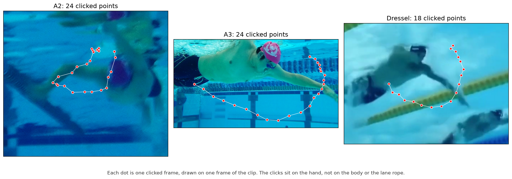

# 2. The data

## The three clips

The project uses three short clips.

| Label | Swimmer | Source file | Resolution | Nominal frame rate | Tracked frames | Hand points | Time base |
|---|---|---|---|---|---|---|---|
| A2 | me | `a2yifan.mov` | 1920 x 1080 | 29.97 fps | 317 to 340 | 24 | real time |
| A3 | me | `a3yifan.mov` | 1920 x 1080 | 29.97 fps | 171 to 194 | 24 | real time |
| Dressel | Caeleb Dressel | `dressel.mp4` | 1280 x 720 | 60 fps | 642 to 778 | 18 | slowed footage |

**A2 and A3 are two clips of the same swimmer, me.** The labels come from the file names. They are not two different people, and they are not two different strokes in a controlled experiment.

The elite clip is Caeleb Dressel in the Tokyo 2020 Olympic 50 m freestyle. The race time in the clip is 21.07 s. The source is a YouTube technique clip (`GyFwUUeNPkE`), and the footage belongs to NBC Sports. It is used for academic analysis only.

The source videos are **not** included in this repository. They are large, and the elite footage is not mine to redistribute. The digitised coordinates, the calibration files, and the result tables are included, so the analysis can be checked without the videos.

## How the hand was digitised

The final data were collected by hand, one frame at a time. Automatic tracking was tried first, but it drifted when the hand crossed the splash, the lane rope, or the body. The final coordinates therefore come from manual clicks.

The clicker is `scripts/track_hand.py`. It opens a video window and shows the current frame with a magnified inset around the cursor. A left click records the hand position for that frame and advances to the next distinct picture. The controls are:

| Key | Action |
|---|---|
| left click | record the hand and advance |
| `d` or space | advance without recording |
| `a` | go back one step |
| `u` | undo the last point |
| `x` | delete the point on the current frame |
| `c` | clear all points |
| `g` | jump to a frame number |
| `s` | save now |
| `q` or Esc | save and quit |

The clicker saves after every click, so a crash loses at most one point. It also draws every recorded point on the frame, so it is easy to see whether a click landed on the hand or on the background.

### Repeated frames

Some video files are stored at a high frame rate but repeat each real picture several times. If the tracker advanced one frame at a time, the window would appear frozen and several clicks would land on the same picture. The clicker therefore compares each new frame with the previous one and skips frames that are visually identical.

The duplicate check is in `outputs/check/duplicate_frames_*.json`:

| Clip | Duplicate frames in the tracked window | Effective picture rate | What it means |
|---|---|---|---|
| A2 | none | 29.97 per second | real time |
| A3 | none | 29.97 per second | real time |
| Dressel | about 3.36 frames per picture | about 17.9 per second | slowed footage |

The A2 and A3 files are real-time clips. The Dressel file is slowed: its 60 fps container does not contain 60 new pictures per second. That is why the Dressel time stamps are nominal and why I do not compare absolute speed with Dressel.

### Which point was clicked

I clicked the **wrist**, at the point where the hand meets the forearm. In a side-on view this point is easier to identify consistently than the fingertip, which blurs into the water. The same point was used in every clip.

The clicks were checked by drawing them back onto the video frames. The checks are in `outputs/check/`. The Dressel clicks were checked in the frames where the hand is clear of the splash. The A2 and A3 clicks were checked in the same way.



*Figure 1. The clicks checked against the video. Each dot is one clicked frame, drawn on one frame of the clip. The clicks sit on the hand, not on the body or the lane rope.*

## Calibration: from pixels to metres

A click gives a position in pixels. To convert pixels to metres, the data need a length of known size in the video.

I used the **swim cap**. The cap is on the swimmer's head, which is at roughly the same distance from the camera as the hand. I measured the cap width in several frames of each clip and assumed a cap width of **0.19 m**, which is about the width of an adult head.

The scale is:

```
scale (m per pixel) = 0.19 m / cap width (pixels)
```

The coordinates are then:

```
x = (x_pixel - x_start) * scale
y = -(y_pixel - y_start) * scale
```

The minus sign on `y` makes upward positive, which is the usual convention in mathematics. The start point is the first clicked frame, so every path starts at `(0, 0)`.

### Calibration table

| Clip | Cap width used | Scale | Relative uncertainty | Notes |
|---|---|---|---|---|
| A2 | 41.3 px, standard deviation 6.1 px, 6 frames | 0.004597 m/px | 18.1% | the cap is small in a wide shot |
| A3 | 148.0 px, standard deviation 16.4 px, 7 frames | 0.001284 m/px | 15.3% | the cap is large and clear, but the head width is still an assumption |
| Dressel | 40.6 px, standard deviation 3.8 px, 5 frames | 0.004680 m/px | 14.1% | the cap is silver and was measured on zoomed frames |

The uncertainty combines two things: the spread of the cap measurements and the uncertainty in the assumed cap width. The JSON files in `data/` record both.

A useful way to read the uncertainty is:

- A2 pull length 0.762 m with 18.1% uncertainty gives about **0.14 m**.
- A3 pull length 1.764 m with 15.3% uncertainty gives about **0.27 m**.
- Dressel pull length 1.418 m with 14.1% uncertainty gives about **0.20 m**.

These are the values in the main table.

### Why the lane rope is not the scale

The pool's lane ropes are 2.5 m apart. That sounds like a better reference than a swim cap, because it is a known pool dimension. In these camera views, however, the lane width is strongly foreshortened. The rope is not perpendicular to the camera, and it is not at the same distance from the lens as the hand.

The check is in `outputs/check/lane_rope_check.json`. Using the lane rope gives the following scales and implied head widths:

| Clip | Cap scale | Lane-rope scale | Ratio | Head width implied by the rope |
|---|---|---|---|---|
| A2 | 0.004597 m/px | 0.013158 m/px | 2.86 | 0.54 m |
| A3 | 0.001284 m/px | 0.005882 m/px | 4.58 | 0.87 m |
| Dressel | 0.004680 m/px | 0.009615 m/px | 2.05 | 0.39 m |

A head width of 0.39 m to 0.87 m is impossible. The lane rope is therefore not a valid scale in these views. It is useful as a cross-check because it shows how badly a foreshortened reference can fail, but the cap is the working scale.

## The data files

| File | What it contains |
|---|---|
| `data/a2_hand_manual.csv` | raw A2 clicks in pixels, with frame number and time |
| `data/a3_hand_manual.csv` | raw A3 clicks in pixels |
| `data/dressel_hand_manual.csv` | raw Dressel clicks in pixels |
| `data/a2_hand_points_metres.csv` | A2 coordinates in metres |
| `data/a3_hand_points_metres.csv` | A3 coordinates in metres |
| `data/dressel_hand_points_metres.csv` | Dressel coordinates in metres |
| `data/a2.calibration_cap.json` | A2 cap measurement, scale, and uncertainty |
| `data/a3.calibration_cap.json` | A3 cap measurement, scale, and uncertainty |
| `data/dressel.calibration_cap.json` | Dressel cap measurement, scale, and uncertainty |
| `data/all_points.csv` | all 66 points in one flat table, with a pull-window flag |

The raw `*_hand_manual.csv` files contain the clicks:

- `frame`: the video frame number.
- `t`: the time stamp in seconds. For Dressel this is the nominal 60 fps time, not physical time.
- `x_px`, `y_px`: the click in image coordinates.

The converted `*_hand_points_metres.csv` files add:

- `x_m`, `y_m`: the position in metres, with the first click at the origin and upward positive.

The `all_points.csv` file uses `t_s` for the time column and adds the swimmer label, the clip name, the video file, the calibration constants, the time base, and an `in_pull_window` flag. It is the easiest file to open in a spreadsheet.

## The checks

The repository includes three checks:

| Check | File | What it shows |
|---|---|---|
| Repeated frames | `outputs/check/duplicate_frames_a2yifan.json`, `duplicate_frames_a3yifan.json`, `duplicate_frames_dressel.json` | A2 and A3 are real time; Dressel is slowed |
| Lane-rope cross-check | `outputs/check/lane_rope_check.json` | the rope is foreshortened and cannot be the scale |
| Click overlays | `outputs/check/` images | the clicked points sit on the hand, not on the body or the rope |

The click overlays are not committed to git because they are images, but they can be regenerated from the videos with the scripts in `scripts/`.

## What the data cannot tell us

The data are a **2D projection** of a 3D motion. If the hand moves toward or away from the camera, that part of the motion is invisible. The data are also from a **single camera**, a **single pull per clip**, and a **calibration that is uncertain by about 15%**. These limits are discussed in [05_limitations.md](05_limitations.md).
