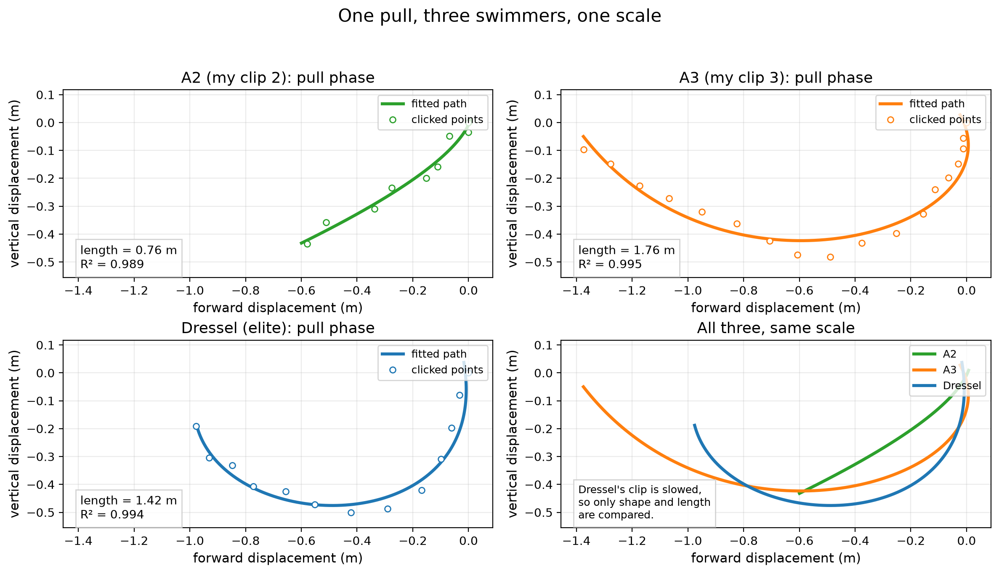

# 4. The results

This page contains every result table. The headline is repeated at the top so the page can be read without scrolling through the details.

## Headline

- **A3 is closer to Dressel than A2 is.** The average gap is 16.5 cm for A3 and 34.1 cm for A2.
- **The shape score agrees.** After allowing one overall size factor, Dressel's curve explains 90.3% of the shape of A3's pull and 64.0% of A2's.
- **A3's pull is larger than Dressel's.** The fitted size factor is 1.128, so Dressel's path is enlarged by about 13% to match A3.
- **A2's pull is smaller and much shorter.** The size factor is 0.538, but A2's pull window is only 0.27 s and 9 points, so this is a short segment of the pull, not a full stroke.
- **All three fits are strong.** The pull-phase R² is between 0.989 and 0.995.

*Figure 1. The pull phase of each clip at the same physical scale. Open circles are the clicked points; solid lines are the fitted polynomials.*

## Full-track fits

The full track uses every digitised frame, including the recovery. It is a check on the whole visible movement, not the headline comparison.

| Clip | Frames | Points | Duration | Degree | R² | Fit RMSE | Forward span | Vertical span | Arc length | Mean speed | Peak speed |
|---|---|---|---|---|---|---|---|---|---|---|---|
| A2 | 317 to 340 | 24 | 0.767 s | 3 / 3 | 0.8275 | 129.3 mm | 0.746 m | 0.551 m | 1.706 m | 2.224 m/s | 6.769 m/s |
| A3 | 171 to 194 | 24 | 0.767 s | 3 / 3 | 0.9910 | 47.0 mm | 1.443 m | 0.603 m | 2.067 m | 2.695 m/s | 5.525 m/s |
| Dressel | 642 to 778 | 18 | 2.267 s | 3 / 3 | 0.9836 | 55.5 mm | 1.022 m | 0.818 m | 1.839 m | 0.812 m/s* | 1.391 m/s* |

*Dressel's speeds are nominal. The elite clip is slowed, so its time base is not physical. The shape and the arc length are still usable.

The A2 full-track fit is the weakest. Its R² is 0.8275, and its residuals are about 13 cm. That is a warning that the A2 full track contains more than one kind of motion. The pull-phase fit is much better because the window is restricted to a single action.

## Pull-phase fits

This is the fair comparison. The pull starts at the frame where the hand is farthest forward and ends at the frame where it is farthest back.

| Clip | Frames | Points | Duration | Degree | R² | Fit RMSE | Forward span | Vertical span | Arc length | Arc uncertainty | Mean speed | Peak speed |
|---|---|---|---|---|---|---|---|---|---|---|---|---|
| A2 | 320 to 328 | 9 | 0.267 s | 2 | 0.9891 | 25.8 mm | 0.579 m | 0.434 m | 0.762 m | ± 0.138 m | 2.854 m/s | 4.541 m/s |
| A3 | 177 to 194 | 18 | 0.567 s | 3 | 0.9945 | 36.5 mm | 1.373 m | 0.481 m | 1.764 m | ± 0.270 m | 3.110 m/s | 4.414 m/s |
| Dressel | 682 to 778 | 13 | 1.600 s | 3 | 0.9939 | 29.7 mm | 0.978 m | 0.501 m | 1.418 m | ± 0.199 m | 0.886 m/s* | 1.232 m/s* |

*Dressel's speeds are nominal and are not compared with the real-time clips.

The fit RMSE is the typical distance between the fitted curve and the clicked points. It is 26 mm to 37 mm, which is small compared with the path lengths. The arc uncertainty is the calibration uncertainty propagated through the length.

## Pairwise comparisons

The full-track RMSE uses every frame. The pull-phase RMSE uses only the pull. The distance is computed after both paths are aligned at the start and put on normalised time.

| Pair | Window | Position RMSE | Mean difference | Maximum difference | Arc-length difference |
|---|---|---|---|---|---|
| A2 vs A3 | full track | 0.6390 m | 0.4785 m | 1.5196 m | 0.3619 m |
| A2 vs Dressel | full track | 0.5693 m | 0.4593 m | 1.2153 m | 0.1338 m |
| A3 vs Dressel | full track | 0.1939 m | 0.1649 m | 0.4342 m | 0.2281 m |
| Dressel vs A3 | pull phase | 0.1650 m | 0.1274 m | 0.4063 m | 0.3460 m |
| Dressel vs A2 | pull phase | 0.3414 m | 0.3165 m | 0.4668 m | 0.6560 m |

### What this table says

- **A3 against Dressel:** the average gap is 16.5 cm, the worst gap is 40.6 cm, and the path lengths differ by 34.6 cm.
- **A2 against Dressel:** the average gap is 34.1 cm, the worst gap is 46.7 cm, and the path lengths differ by 65.6 cm.
- **A2 against A3:** the full-track gap is 63.9 cm, which is larger than the A3 against Dressel gap. A2 and A3 are quite different from each other. That is not surprising: they were filmed at different distances, and A2's pull window is much shorter. It is a reason to treat A2 and A3 as two separate clips, not as repeat trials of the same stroke.

The pull-phase A2 against Dressel gap is 34.1 cm, which is smaller than the full-track gap of 56.9 cm. The pull phase is closer because the recovery is removed. That is the expected direction: the pull is the part where the two paths are most similar.

## Shape scores and the size factor

The raw R² penalises a path that has the right shape but the wrong size. The scaled R² fits one overall size factor first, so it isolates shape. The rotated R² also allows one rotation, as a robustness check.

| Source model | Target data | Degree | Raw R² | Scaled R² | Rotated R² | Rotation | Size factor | Model RMSE |
|---|---|---|---|---|---|---|---|---|
| Dressel | A3 | 3 | 0.8727 | 0.9026 | 0.9332 | 6.5° | 1.128 | 175.4 mm |
| Dressel | A2 | 3 | -0.9137 | 0.6401 | 0.7850 | -14.7° | 0.538 | 342.5 mm |
| A3 | Dressel | 3 | 0.7797 | 0.8752 | 0.9148 | -6.6° | 0.847 | 178.8 mm |
| A2 | Dressel | 3 | 0.1881 | 0.5826 | 0.7464 | 14.0° | 1.628 | 343.3 mm |

The first two rows are the headline. The other two rows run the model in the opposite direction, from my path to Dressel's, as a check. The asymmetry is expected: a model fitted to a short, coarse path is a weaker predictor than a model fitted to a longer, smoother path.

### Reading the size factor

The size factor `k` is the number that multiplies **Dressel's** path to sit on mine.

- `k = 1.128` for A3 means Dressel's path is enlarged by 12.8% to match A3. A3's path is larger.
- `k = 0.538` for A2 means Dressel's path is shrunk to 53.8% to match A2. A2's path is smaller.

The size factor is not a body-size measurement. It is a summary of the relative path length in the video, and it inherits the calibration uncertainty.

### Why the raw R² can be negative

A negative R² means the model is worse than simply using the mean of the data. For Dressel's model on A2, the raw R² is -0.91. That sounds dramatic, but it is mostly a **size** effect: Dressel's path is much larger than A2's short pull segment, so the unscaled model overshoots. Once one size factor is allowed, the R² rises to 0.64. The scaled number is the fairer shape comparison.

## The rotation check

The rotated R² allows one rotation as well as one scale. It answers a slightly different question: if the camera angles differed by a few degrees, would the shapes agree?

- A3: 0.9332 at a rotation of 6.5°.
- A2: 0.7850 at a rotation of -14.7°.

The ranking does not change. A3 is still closer to Dressel. The rotation needed for A3 is small, which is consistent with the two side-on camera angles being similar. The rotation needed for A2 is larger, which is consistent with the different camera position and the shorter window.

## How much should you trust the numbers?

The calibration uncertainty is about 14% to 18%. That is larger than the 16.5 cm A3 against Dressel RMSE. The absolute gap should therefore be read as **"about 16 cm in this calibration"**, not as a precise physical distance.

The shape score is more robust because it removes one overall size factor. It still depends on the calibration through the shape of each path, but a single scale error on one clip cannot dominate it in the same way. That is why the README leads with both numbers and explains which one answers which question.

The path-length differences carry the uncertainty directly:

| Comparison | Length difference | Combined uncertainty | Difference divided by uncertainty |
|---|---|---|---|
| A3 vs Dressel | 0.346 m | 0.335 m | about 1.0 |
| A2 vs Dressel | 0.656 m | 0.242 m | about 2.7 |
| A2 vs A3 | 1.002 m | 0.303 m | about 3.3 |

The A3 against Dressel length difference is about the same size as its combined uncertainty. That means the data do **not** establish that A3's pull is physically longer than Dressel's. They establish that the visible paths have a similar shape, with A3's path somewhat larger in this calibration. The A2 differences are larger relative to their uncertainty, but A2's short window makes the length comparison less meaningful.

This is the honest reading: the shape comparison is the strong result, and the absolute lengths are indicative.

## Summary

| Question | Answer | Confidence |
|---|---|---|
| Is the hand path smooth enough to model? | Yes, R² 0.989 to 0.995 | strong |
| Is A3 closer to Dressel than A2? | Yes, 16.5 cm against 34.1 cm | moderate to strong |
| Does the shape score agree? | Yes, 0.90 against 0.64 | moderate to strong |
| Is A3's path longer than Dressel's? | Slightly, 1.76 m against 1.42 m, but the difference is about one combined uncertainty | weak |
| Is A2 a fair second trial? | No, 9 points over 0.27 s | weak |
| Can I compare speed with Dressel? | No, the elite clip is slowed | not possible |

The next page explains the limits in more detail.
